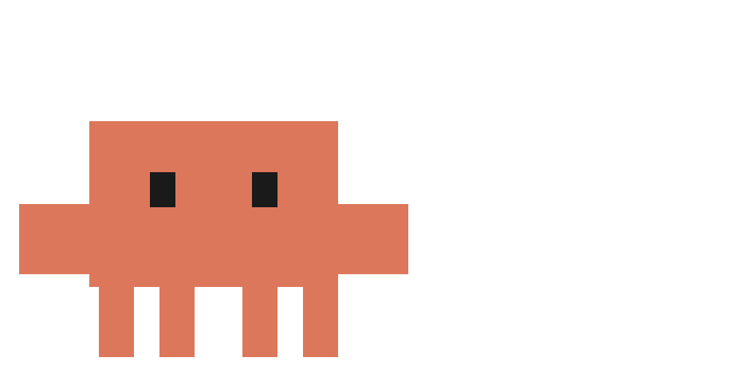

# clawdoodle

A [Claude Code](https://claude.com/claude-code) skill that turns a topic into a short, looping animation of **Clawd** (the Claude Code mascot) doing something that stands for it.

> "Clawd explaining what a cache is" → a transparent GIF **and** a self-contained animated SVG.



*Example: `/clawdoodle Clawd thinks a lot` — [GIF](examples/pensar-mucho.gif) · [animated SVG](examples/pensar-mucho.svg) · [scene](examples/pensar-mucho.scene.json)*

## What you get

- `final.gif`: transparent background, 33 fps, loops seamlessly.
- `final.svg`: one `.svg` file, no JavaScript (CSS keyframes), works in ``, browsers and HTML slides. Usually 20–100 KB.
- Edit by talking: "slower", "add a book", "remove the desk", "another topic", "undo". Every change edits a `scene.json`, never the GIF, and each version is saved so you can revert.

## Requirements

- macOS or Linux, Python 3.9+
- Google Chrome (used headless to render the SVG/GSAP scenes)
- [Claude Code](https://claude.com/claude-code)
- Pillow (installed automatically by the setup script)

## Install

### Option A: use it inside this repo

```bash
git clone https://github.com/diegochoqueramirez/clawdoodle.git
cd clawdoodle
.claude/skills/clawdoodle/scripts/setup.sh
claude
```

Claude Code discovers the skill automatically when opened in the repo.

### Option B: install it for every project (personal skill)

```bash
git clone https://github.com/diegochoqueramirez/clawdoodle.git
mkdir -p ~/.claude/skills
cp -R clawdoodle/.claude/skills/clawdoodle ~/.claude/skills/clawdoodle
~/.claude/skills/clawdoodle/scripts/setup.sh
```

`setup.sh` creates `engine/.venv` with Pillow, checks for Chrome and runs `clawd doctor`. It must finish with `OK`.

## Use

In Claude Code, run the slash command with a topic (any language):

```
/clawdoodle Clawd explaining what a cache is
/clawdoodle quiero que clawd piense mucho
```

Claude picks one visual metaphor, builds the scene, checks it, renders a preview and delivers the files under `./clawdoodles/<slug>/out/` in your working directory. Then keep asking for changes in plain language.

## How it works

```
.claude/skills/clawdoodle/
  SKILL.md        instructions for Claude (workflow, rules, commands)
  engine/         SVG + GSAP scene engine, Pillow GIF export, validator, SVG baker
    scenes/       11 worked example scenes (thinking, cache, database, ...)
    VOCAB.md      what a scene may contain (props, poses, actions)
    STYLE.md      art and timing rules
  reviewer/       checklist and brief for the optional reviewer agent
  scripts/setup.sh
```

A scene is a small JSON file: pixel-grid sprites with named colors plus a timeline of poses and actions. The engine validates it, renders it in headless Chrome and exports the GIF; the SVG is baked from the GSAP timeline sampled at 60 fps and checked against the GIF render (`clawd export-svg --verify`).

### CLI (what the skill runs for you)

```bash
clawd() { .claude/skills/clawdoodle/engine/.venv/bin/python .claude/skills/clawdoodle/engine/clawd.py "$@"; }
clawd new my-topic --from thinking   # start from an example
clawd check my-topic                 # validate
clawd render my-topic                # preview + review pack
clawd render my-topic --final        # GIF + animated SVG
clawd save my-topic -m "first version"
clawd --help
```

See [docs/design.md](docs/design.md) for the design notes (in Spanish).

## Notes

- Style is fixed on purpose: flat 2D, one body color, named palette, no text inside the animation, transparent background.
- Clawd is Anthropic's mascot; this is an unofficial fan project and is not affiliated with or endorsed by Anthropic.

## License

[MIT](LICENSE)
